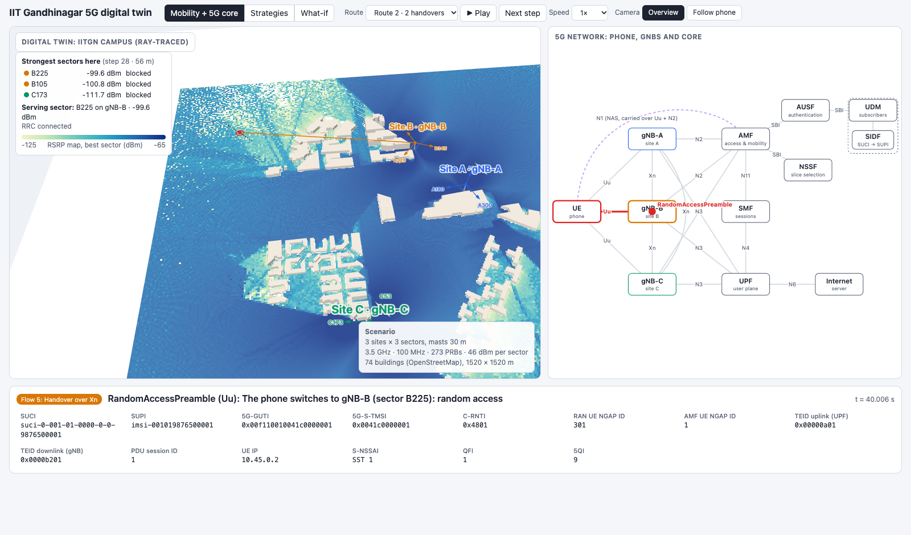

# IIT Gandhinagar 5G digital twin

A ray-traced digital twin of a 5G network on the IIT Gandhinagar campus (3 sites × 3 sectors, 3.5 GHz). It is
used to compare ways of allocating radio resources (two baselines against a twin-driven strategy), and to show
the 5G core flow (registration, PDU session, Xn handover, paging) as a phone walks across the campus.



## Tools

- **Sionna RT 2.2.0:** the ray tracer that computes the radio channels on the campus
- **Mitsuba 3.9.1 / Dr.Jit 1.5.0:** the rendering engine under Sionna (runs on the CPU here, or on an NVIDIA GPU)
- **Python 3.14.7** with NumPy 2.5.4 and Matplotlib 3.11.2; exact versions in [requirements.txt](requirements.txt)
- **three.js r128:** the 3D view in the page (bundled in [vendor/](vendor/), so the page works offline)
- **OpenStreetMap:** the 74 campus buildings

## Quick start

```
python3 -m venv .venv && source .venv/bin/activate
pip install -r requirements.txt                           # a few minutes, once
python run.py && open twin.html                           # the demo: built in about 1 second, opens offline
for n in 1 2 3 4 5 6 7 8; do python tasks/task${n}_*.py; done   # the full study
```

**Run times on an Apple M4 laptop:**
- **The demo:** about 1 s to build. It needs no packages.
- **The full study:** about 25 minutes from scratch. Of that, ray tracing takes about 8 minutes and the timing
  benchmark about 15; with the traces already saved it takes about 15 minutes.
- **Quick mode:** add `--quick` to every task for a check that runs in under a minute.

## How it works

1. **Build the campus.**
   - [config.py](config.py) holds the 3 sites and 9 sectors, the handover rule and the 5G identities.
   - [twin/scene.py](twin/scene.py) loads the OpenStreetMap campus into Sionna RT and places the sectors.
   - [tasks/task1_scenario.py](tasks/task1_scenario.py) lists every radio and environment parameter.
2. **Ray-trace channels and measurements.**
   - [tasks/task2_measurements.py](tasks/task2_measurements.py) traces 20 random placements of 100 UEs. For
     each UE and sector it gives RSRP, SINR, line of sight and path loss, saved in `data/`.
   - [twin/radio.py](twin/radio.py) holds the formulas (power, noise, SINR, CQI → bits).
3. **Allocate.** [twin/allocation.py](twin/allocation.py) has three strategies. Each UE needs 12 PRBs.
   - **B1:** the nearest site, with fixed PRB blocks.
   - **B2:** the nearest site, with random PRBs.
   - **Twin:** the strongest ray-traced sector, with neighbouring sectors that interfere strongly given
     different PRBs.

   [tasks/task3_baseline.py](tasks/task3_baseline.py) and
   [tasks/task4_twin_allocation.py](tasks/task4_twin_allocation.py) run them on one placement.
4. **Compare KPIs.** [tasks/task6_compare.py](tasks/task6_compare.py) runs all three on the 20 placements. It
   reports SINR, throughput, interference and PRB use as mean ± 95 % interval, with a table and 3 plots in
   `results/`.
5. **Move the phone.** [tasks/task5_mobility.py](tasks/task5_mobility.py) re-traces three walking routes and
   applies the A3 handover rule (3 dB, 2 steps). It works out the walker's throughput under B1 and the Twin,
   and writes the routes into the demo's [data/twin.json](data/twin.json).
6. **The 5G core flow.**
   - [run.py](run.py) walks the phone along a route through a message-by-message model of the network. That
     model lives in [net/](net/): the [UE and gNBs](net/ran.py), the [core](net/core.py), the [identities](net/ids.py)
     and the [message clock](net/sim.py).
   - It then builds `twin.html` from [viewer.html](viewer.html).
   - [test_flows.py](test_flows.py) checks the flows follow the class order.
7. **Predict before changing.** [tasks/task7_whatif.py](tasks/task7_whatif.py) predicts three changes (2× UEs,
   site B off, UEs moved ~30 m) and compares them with a re-run under random shadowing.
   [tasks/task8_platform.py](tasks/task8_platform.py) measures the ray-tracing time and memory.

Task 1, 6 and 7 results also feed the page's Scenario box and its Strategies and What-if tabs, through
[data/demo_tasks.json](data/demo_tasks.json). [PROGRESS.md](PROGRESS.md) has the full status and every number.

## Key results

The table is for 20 random placements of 100 UEs (mean ± 95 % interval).

| | B1 (nearest, fixed) | B2 (nearest, random) | Twin |
|---|---|---|---|
| Mean UE throughput (Mbps) | 6.48 ± 0.50 | 8.67 ± 0.35 | **10.92 ± 0.50** |
| 5th-percentile throughput (Mbps) | 0.00 | 0.05 | **1.33** |
| Mean interference (dBm per PRB) | −66.8 | −69.6 | **−72.0** |

- **Walking routes:** 0, 2 and 1 Xn handovers on routes 1–3. The Twin leaves the walking phone at 0 Mbps on
  0–6.5 % of steps, against 50–76 % for B1.
- **What-if:** the Twin predicts mean throughput within 0.85 Mbps of the re-run.
- **Ray-tracing cost:** 20–30 ms per UE–sector link at 1 M rays on the M4 CPU, using under 1.1 GB of memory.

## Limitations

- **The scene:** OpenStreetMap has no trees or terrain, and some building heights are assumed.
- **The channel and traffic:** each link has one gain across the band, with no fast fading, and every UE
  wants the same 12 PRBs.
- **The comparisons:**
  - The what-if "actual" is the twin plus random shadowing, not a real network.
  - The 5G core's timings and security values are illustrative.
