# 5G RAN Digital Twin for Channel-Aware Resource Allocation and Network What-If Analysis

*5G and Beyond — Semester I project, 2026*

---

## Abstract

We build a site-specific digital twin of a 3-site, 9-sector NR band n78 (3.5 GHz, 100 MHz) network
on the IIT Gandhinagar (Palaj) campus using NVIDIA Sionna RT, a GPU/CPU ray tracer from NVIDIA's
Aerial/Sionna ecosystem. The scene is built from OpenStreetMap building footprints. The twin
produces per-link, per-PRB channel responses for 1,650 UE locations. A slot-level downlink
simulator turns these into 5G KPIs (SINR, CQI, throughput, interference, PRB utilisation, fairness).

The campus is open and low-rise, so most users see several sites and the network is
interference-limited. Using twin channel knowledge for cell association, frequency-selective
proportional-fair scheduling and inter-cell PRB coordination raises mean UE throughput by
**137 %** over a nearest-site / fixed-PRB baseline (23.3 → 55.3 Mbps). It also lifts cell-edge
(5th-percentile) throughput from **0 to 15.1 Mbps** and cuts outage from **22.7 % to 0.2 %**.
For **41 %** of locations the nearest site is not the best server.

We then test the twin against a deliberately different "physical network": deeper ray tracing,
different building materials, shadowing, small-scale fading and 5 m UE position error. A twin
that is *not* synchronised with the network keeps only part of its advantage (29.6 vs 21.5 Mbps
mean). A twin synchronised with standard UE measurement reports keeps most of it (45.7 Mbps mean,
11.9 Mbps at the 5th percentile, no outage). It also predicts the effect of what-if changes
(UE density ×2 / ×3.3, an event hotspot, 40 MHz carrier, switching a site off, scheduler
rollback) to within **2.8 percentage points** on average, versus **18.4 points** for a 3GPP
TR 38.901 statistical model. Finally, a site-layout what-if shows that rooftop-centre masts are
shadowed by their own roofs, and that the twin's gain must be quoted against a sensibly planned
baseline (§10).

---

## 1. Background: what a network digital twin is

3GPP TR 28.915 (Rel-19) defines a network digital twin (NDT) as a virtual replica of a mobile
network, or part of it, that captures its attributes, behaviour and interactions. Its main
elements are:

- **Data** that keeps the twin synchronised with the managed network.
- **Models**, either *emulation* (duplicating real network functions) or *simulation*
  (mathematical models of behaviour).
- **What-if analysis**: a consumer configures a scenario, runs it on the replica and receives
  a report on its impact, *without changing the live network*.

The TR studies use cases such as RAN energy-saving policy verification (§5.1), configuration
verification (§5.9), generating ML training data (§5.6) and topology/traffic visualisation (§5.8).

This project implements a small but complete NDT of the simulation type:

| NDT element (TR 28.915) | This project |
|---|---|
| Physical network | High-fidelity stand-in (§3.4), since no live network was available |
| Twin model | 3D campus scene + RUs + UEs, ray-traced with Sionna RT (`dt/twin.py`) |
| Data / synchronisation | UE SS-RSRP measurement reports used to calibrate the twin (§6.3) |
| Analytics & decisions | KPI engine + 5 allocation strategies (`dt/kpi.py`, `dt/alloc.py`) |
| What-if | 6 scenarios predicted before "applying" them (§8), plus a site-layout what-if (§10) |
| Visualisation | Coverage, best-server, association and PRB-grid views (Figs 1–3, 6, 9) |

## 2. Choice of framework

The brief suggests NVIDIA Aerial Omniverse Digital Twin (AODT). AODT needs an NVIDIA GPU of
compute capability SM 8.0/8.6/8.9/9.0 (A100, RTX 30/40-series, L40/L40S, H100), an NGC API key,
and membership in NVIDIA's 6G Developer Program. Our compute environment had **no NVIDIA GPU** (an Apple-silicon Mac CPU),
so AODT could not be run.

We therefore used **Sionna RT 2.2**, NVIDIA's open-source ray tracer. Published comparisons
report functionally identical EM propagation effects to AODT, with AODT faster at large scale and
adding mobility and RAN features. Sionna RT runs on CPU through Mitsuba's LLVM backend and
switches to CUDA automatically when a GPU is present.

The code is structured so the radio layer can be swapped: everything downstream of
`DigitalTwin.trace()` consumes a `ChannelSet`, i.e. per-PRB channel power `H2[UE, RU, PRB]`
plus geometry. AODT's CFR/raypath output can be loaded into the same structure (README).

## 3. Scenario and twin construction (Task 1)

### 3.1 Scenario

`tools/build_scene.py` built the scene from OpenStreetMap: a 1.4 km × 1.4 km box centred at
23.2107° N, 72.6872° E. Wikipedia's campus coordinate (23.2114, 72.6821) lies about 520 m west of
the buildings, which left half the box empty and cut off the Sports Complex and Guest House, so
we moved the centre. The box holds 74 buildings covering 4.9 % of the area. Only 28 % of them
have OSM height tags (Academic Blocks 10–12: 24 m; Kyzeel and Lekhaag hostels: 20 m; most other
hostels: 7 m). The rest default to 12 m. Footprints are extruded to prisms with ITU-R P.2040
concrete walls over a medium-dry-ground plane.

| Parameter | Value |
|---|---|
| Scene | IIT Gandhinagar campus, OpenStreetMap footprints → `scenes/iitgn/iitgn.xml` |
| Area of interest | 1,300 m × 1,300 m |
| Carrier | 3.5 GHz (n78), 100 MHz, 30 kHz SCS → 273 PRBs, 0.5 ms slot |
| Sites | 3 gNB sites × 3 sectors = 9 RUs; 30 m ground towers next to the Sports Complex, Academic Block 12 and Kyzeel Hostel, sectors rotated per site (§10) |
| RU | 8° downtilt, 46 dBm (10.8 dBm per RE), TR 38.901 sector element (8 dBi, 65° HPBW) |
| UE | 1.5 m, isotropic, NF 9 dB; noise −109.4 dBm per PRB |
| UE locations | 1,500 uniform outdoor points + 150 in a 45 m event hotspot (Fig. 1) |
| Traffic | Full-buffer downlink |

The site and sector parameters are listed per site in `results/iitgn/tables/t1_parameters.csv`.

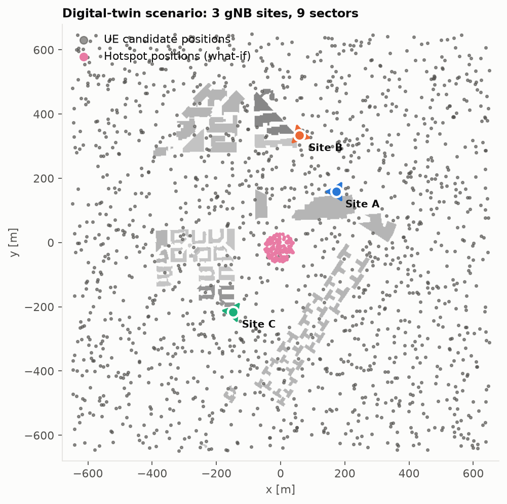

*Fig. 1 — Scenario: building heights (grey), the three sites with sector boresights, and the
candidate UE positions. UE positions are sampled only outdoors, at least 1.5 m from any wall.*

### 3.2 Configuration parameters the twin exposes

All parameters live in `config/iitgn.yaml`:

- **Radio:** carrier frequency, bandwidth, SCS/numerology, number of PRBs, noise figure, overhead,
  BLER target.
- **RAN:** site positions, per-site RU height and sector azimuths, downtilt, Tx power, antenna
  pattern, beamforming gain.
- **Environment:** the scene (any Mitsuba XML; ours is generated from OpenStreetMap by
  `tools/build_scene.py`), and each material's permittivity, conductivity and scattering coefficient.
- **Propagation solver:** max interactions per path, rays per transmitter, and which
  interactions are enabled (LOS, specular reflection, diffuse scattering, refraction,
  wedge/edge diffraction).
- **UEs:** positions, height, antenna, mobility.

The equivalent AODT controls are documented in §9.

### 3.3 Two ray-tracing fidelity profiles

| | Twin (fast) | Physical (stand-in) |
|---|---|---|
| Max interactions | 3 | 4 |
| Rays per RU | 1.4 × 10⁶ | 4.6 × 10⁶ |
| Diffraction (wedge + edge) | yes | yes |
| Building materials | ITU defaults | permittivity ×1.4, conductivity ×2 |
| Shadowing (unmodelled objects) | — | 4 dB log-normal per link |
| Small-scale fading | — | frequency-correlated Rayleigh on NLOS links |
| UE positions known to the operator | true / ±5 m GPS error | true |
| Runtime, 1,650 UEs × 9 RUs (Apple-silicon CPU, LLVM) | 405 s (469 s at GPS positions) | 1,724 s |

### 3.4 Why a "physical network" stand-in

The brief asks to evaluate allocations "before applying them to the network". With no live
network, we follow standard practice in the NDT literature: a higher-fidelity model with effects
the twin does not know about plays the role of the real network. Every decision in Task 7 is made
on the twin and *scored* on the stand-in. This makes the sim-to-real gap measurable rather than
assumed away.

### 3.5 Links the ray tracer cannot resolve

On the open campus the depth-limited ray tracer finds a path for 99.5 % of RU–UE links. The
remaining 0.5 % are filled with TR 38.901 UMa-NLOS path loss plus the sector pattern, shifted by
**+6.8 dB**. That offset is the median residual between the twin's resolved NLOS links and the
same model, so filled links are as strong as a typical resolved NLOS link. Fig. 4 shows the filled
links in grey.

## 4. Site-specific channel information and RAN measurements (Task 2)

For every UE–RU pair the twin exports:
- the channel frequency response at all 273 PRB centres,
- wideband path gain, SS-RSRP, LOS flag and whether a ray path was found,
- RMS delay spread and number of paths.

From these we derive per-UE RAN measurements: best-server RSRP, RSRQ (full load), geometry
SINR, CQI, and the margin to the second-best cell.

Deliverables:
- `results/iitgn/tables/t2_channel_database.csv` (13,500 links: 1,500 uniform UEs × 9 RUs)
- `results/iitgn/tables/t2_ue_measurements.csv`
- `data/iitgn/*.npz` (full per-PRB arrays)

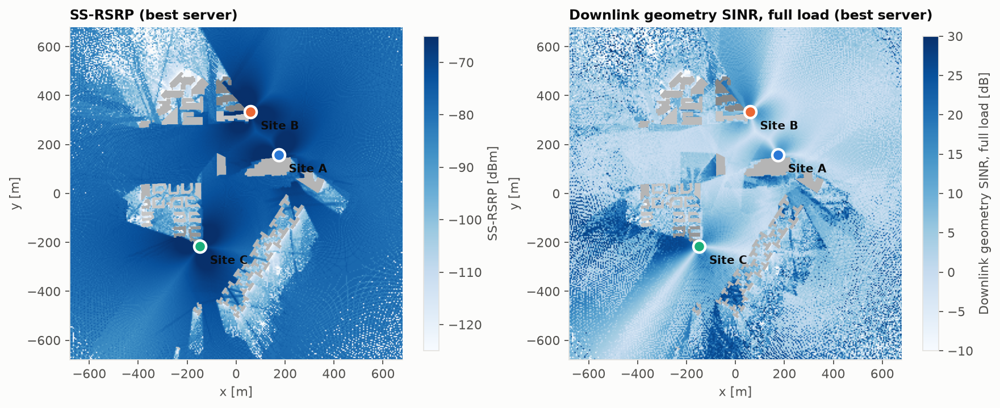

*Fig. 2 — Best-server SS-RSRP and full-load geometry SINR. Signals are strong almost everywhere,
but SINR is limited by the neighbouring sites that most locations also see in LOS.*

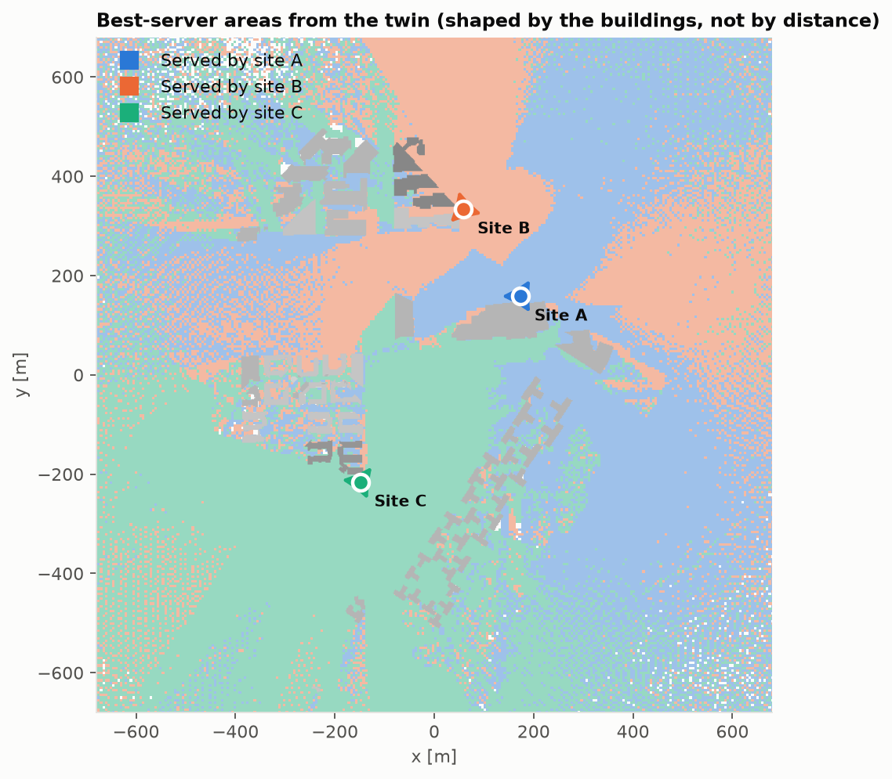

*Fig. 3 — Best-server areas. They are not the regions a distance model predicts: buildings, the
antenna pattern and the rotated sectors decide which site is strongest.*

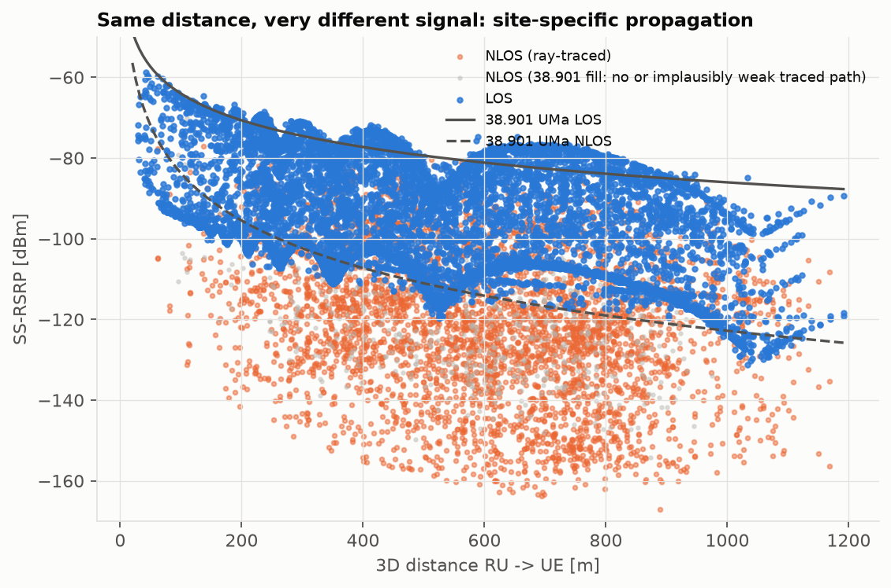

*Fig. 4 — RSRP vs distance for all links. At 150–200 m the 5th–95th-percentile spread is
**52 dB**. LOS links follow the 38.901 LOS curve; NLOS links behind buildings fall far below it.*

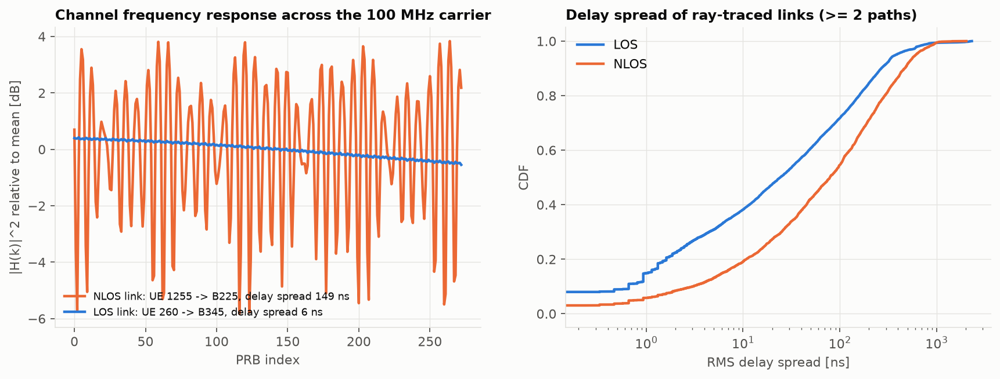

*Fig. 5 — Left: a LOS link is almost flat over 100 MHz, while an NLOS link fades across PRBs.
Right: delay-spread CDFs. This frequency selectivity is what the PF scheduler exploits.*

| Measurement (1,500 uniform UEs) | Value |
|---|---|
| Links with geometric LOS | 68.4 % |
| UEs whose best server is in LOS | 84.9 % |
| UEs whose best server is **not** at the nearest site | **41.7 %** |
| Median best-server RSRP / RSRQ / SINR / CQI | −77.7 dBm / −12.2 dB / 4.1 dB / 3 |
| Median ray-traced paths per link | 18 |
| Median delay spread, LOS / NLOS (links with ≥2 paths) | 24 ns / 78 ns |

## 5. Allocation strategies (Tasks 3 and 4)

### 5.1 Downlink model

Each RU spreads its power equally over the PRBs it uses. For UE *u* served by RU *s* on PRB *k*:

  SINR(u,k) = P_prb · |H_s,u(k)|² / ( Σ_{j≠s, j active on k} P_prb · |H_j,u(k)|² + N_prb )

Link abstraction works per transport block, using all PRBs the UE got in that slot:
- **Effective SINR** (mutual-information averaging): SINR_eff = 2^{mean_k log₂(1+SINR_k)} − 1.
- **CQI** from SINR_eff, using the TS 38.214 Table 5.2.2.1-3 (256QAM) efficiencies. Each CQI
  threshold is placed 3 dB from the Shannon bound.
- **Bits per slot** = efficiency × PRBs × 12 × 14 × (1 − 0.14 overhead) × (1 − 0.1 BLER).
  At 256QAM this gives 584 Mbps for one layer over 100 MHz, matching TS 38.306.

Link adaptation always uses the *real* channel (CQI feedback). Association and scheduling use
whatever the operator *believes*: geometry for the baselines, the twin for T1–T3.

### 5.2 Strategies

| ID | Association | PRB allocation | Twin knowledge used |
|---|---|---|---|
| **B1** | Nearest site; sector by bearing | Fixed equal contiguous blocks | none (geometry only) |
| **B2** | Nearest site; sector by bearing | Random every slot | none |
| **T1** | Max RSRP from twin | Fixed equal blocks | wideband gain |
| **T2** | Twin load-aware: start from max-RSRP, move UEs (within 8 dB) when it raises Σ log(predicted rate) | Frequency-selective proportional fair (PF), per-PRB | per-PRB SINR |
| **T3** | as T2 | PF + **twin-predicted coordinated muting**: on each PRB, greedily silence the cell whose silence most increases the PF-weighted predicted sum rate | per-PRB channels to *all* RUs |

T3 is a light form of coordinated scheduling (CoMP-CS). It can only be done with a twin, because
it needs each UE's channel from *every* neighbouring RU on *every* PRB.

## 6. Results: baseline vs twin-assisted (Task 6)

30 Monte Carlo drops × 30 UEs × 40 slots, twin channels as ground truth. ± values are 95 %
confidence intervals over the drops (`results/iitgn/tables/t6_kpi_ci95.csv`).

| KPI | B1 | B2 | T1 | T2 | **T3** |
|---|---|---|---|---|---|
| Mean UE throughput [Mbps] | 23.3 ± 2.2 | 23.3 | 33.0 | 33.8 | **55.3 ± 2.5** |
| Cell-edge (5th pct) throughput [Mbps] | 0.0 | 0.0 | 4.8 | 6.9 | **15.1 ± 1.4** |
| Median UE throughput [Mbps] | 9.2 | 9.2 | 18.4 | 21.7 | **42.8** |
| Mean effective SINR [dB] | −0.6 | −0.5 | 6.0 | 6.9 | **16.0** |
| Mean interference [dBm/PRB] | −74.9 | −74.9 | −75.8 | −76.4 | **−83.3** |
| Mean CQI | 3.5 | 3.5 | 4.4 | 4.8 | **9.4** |
| PRB utilisation [%] | 100 | 100 | 100 | 100 | 67.6 |
| Jain fairness | 0.31 | 0.31 | 0.44 | 0.52 | **0.65** |
| Outage (< 1 Mbps) [%] | 22.7 ± 2.8 | 22.6 | 0.3 | 0.3 | **0.2 ± 0.3** |
| Spectral efficiency per loaded cell [bit/s/Hz] | 0.87 | 0.87 | 1.13 | 1.15 | **1.87** |

All T-vs-B differences in mean throughput are well outside the confidence intervals.

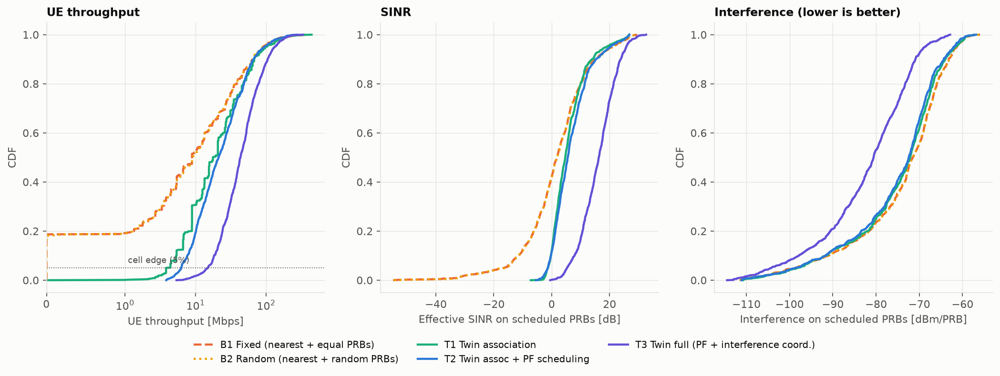

*Fig. 7 — CDFs of UE throughput, effective SINR and interference.*

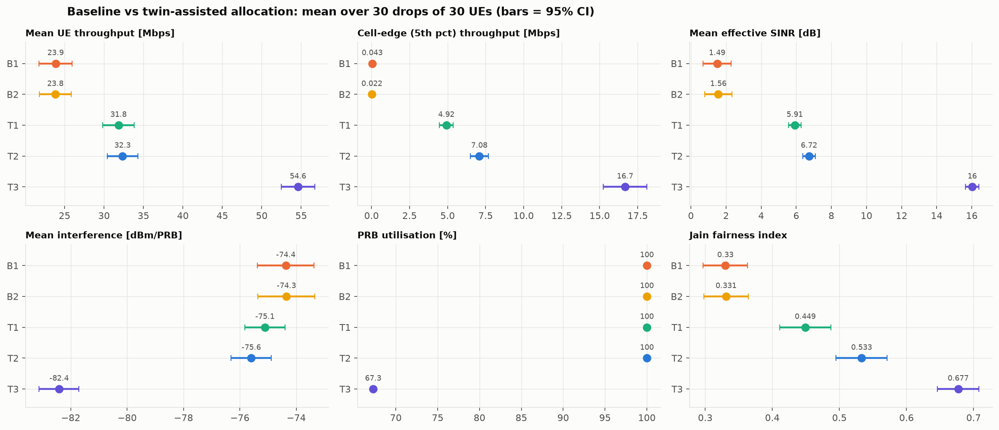

*Fig. 8 — Mean KPIs with 95 % confidence intervals.*

**What the numbers say**

1. **Association removes the outage (B1 → T1).** About one UE in five gets no usable link from
   its nearest site, so B1's cell-edge throughput is zero. Using the twin's RSRP cuts outage from
   22.7 % to 0.3 % and raises mean throughput by 42 %. Random PRB allocation (B2) changes nothing,
   because the problem is *who* serves, not *which* PRBs.
2. **Frequency-selective PF (T1 → T2)** raises the median by 18 % and fairness from 0.44 to 0.52
   by giving each UE the PRBs where its own channel peaks (Fig. 5).
3. **Twin-predicted interference coordination (T2 → T3) is the largest single gain on this
   site.** The campus is interference-limited: most UEs see two or three sites in LOS. T3 mutes
   about a third of PRB-cell pairs (Fig. 9), lowers mean interference by 6.9 dB and raises SINR by
   9 dB. Total throughput still *rises* by 63 %, so the twin finds PRBs where silence pays.

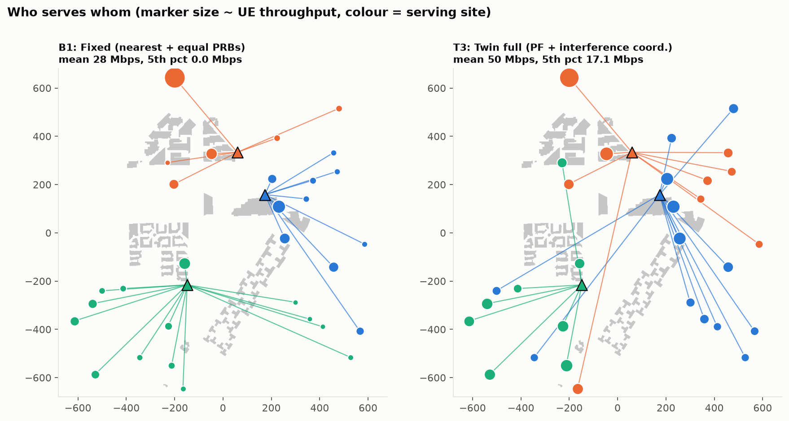

*Fig. 6 — One drop: B1 (left) vs T3 (right). Marker size shows throughput.*

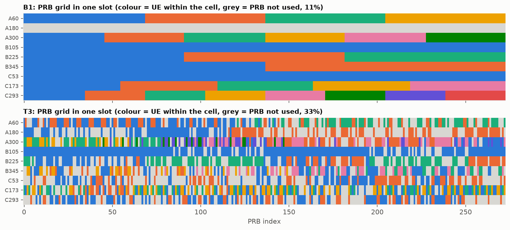

*Fig. 9 — One slot's PRB grid per RU. B1 uses fixed blocks; T3 interleaves UEs by channel
quality and leaves grey PRBs muted where they would hurt a neighbour more than they help.*

### 6.3 How accurate does the twin need to be?

The table above assumes the twin *is* the network. Fig. 16 relaxes that: decisions come from
increasingly imperfect twins and are scored on the physical stand-in.

| Twin used for decisions | Best-server agreement | B1 mean / 5th pct | T3 mean / 5th pct | T3 outage |
|---|---|---|---|---|
| Oracle (= physical network) | 100 % | 21.4 / 0.0 | **55.6 / 16.4** | 0.0 % |
| Twin + measurement sync, GPS positions | 90 % | 21.5 / 0.0 | **45.7 / 11.9** | 0.0 % |
| Twin at true positions, no sync | 75 % | 21.4 / 0.0 | 32.5 / 5.4 | 3.6 % |
| Twin at GPS positions (5 m), no sync | 74 % | 21.5 / 0.0 | 29.6 / 4.5 | 2.9 % |

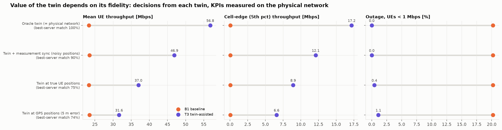

*Fig. 16 — The value of twin-assisted allocation depends on twin fidelity.*

This is the most important result of the project. **An unsynchronised twin loses most of its
advantage**: it agrees with the network on only three best servers out of four, and T3 falls from
55.6 to about 30 Mbps. It still beats the baseline here (the baseline is very poor on this site),
but it is not a safe basis for fine-grained decisions such as PRB muting.

**Synchronisation** fixes most of it. Each UE reports SS-RSRP for its 8 strongest cells, as in an
NR measurement report (1 dB resolution, ~2 dB error). The twin keeps its frequency-selective shape
but rescales each reported link to the measured level. This is the "data" element of TR 28.915,
and it is what AODT 1.5's *EM calibration from geo-tagged RSRP traces* automates.

## 7. Mobility and environment changes (Task 5)

Three 130 m walking routes were chosen automatically from the twin's own radio map, picking the
routes with the most best-server changes (Fig. 10). Each was traced every 2 m alongside 29 static
UEs. The twin re-associates the moving UE with an A3-like event: neighbour 3 dB better for two
consecutive steps (≈3 s time-to-trigger at walking speed). The baseline keeps the nearest site.

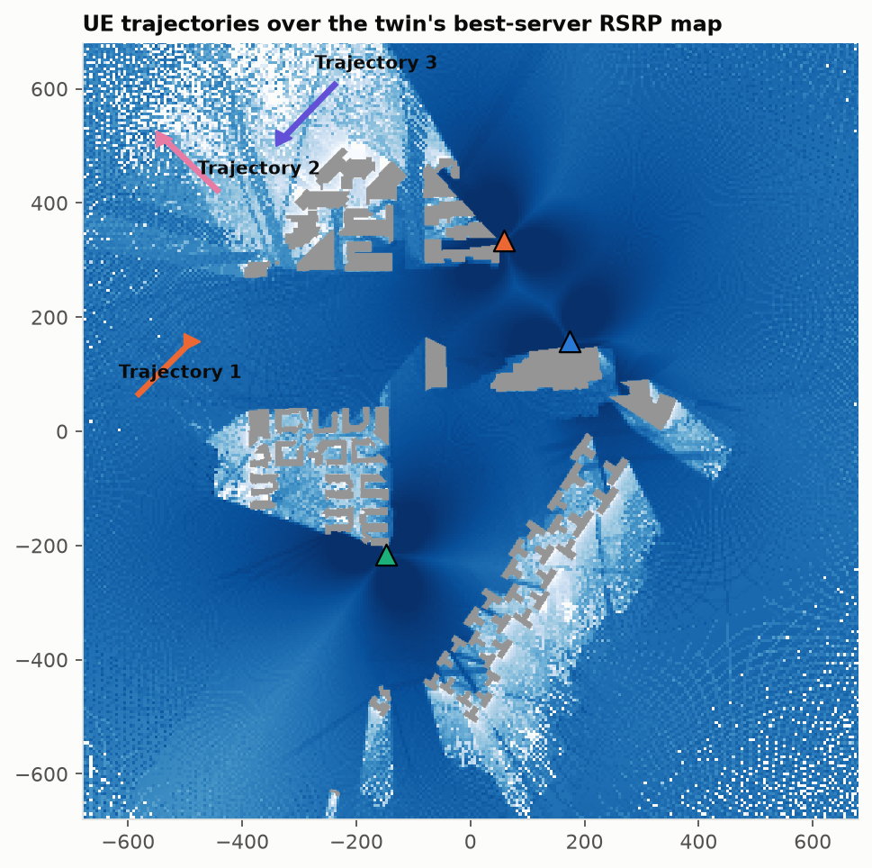

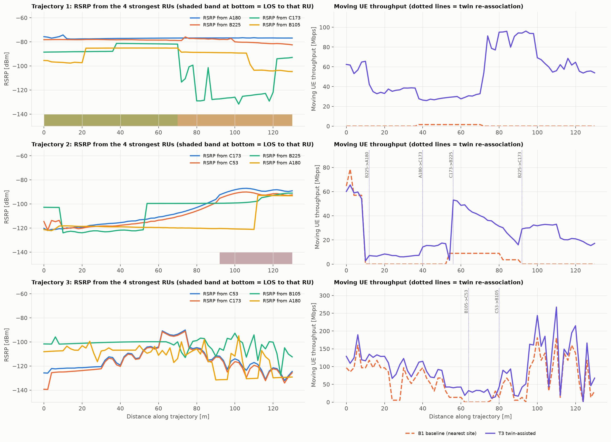

*Fig. 11 — Left: RSRP from the four strongest RUs along each route. Right: the moving UE's
throughput, with dotted lines marking twin re-associations.*

| Route | Mean thr. T3 / B1 [Mbps] | 10th-pct thr. T3 / B1 | Mean SINR T3 / B1 [dB] | Twin handovers | Steps with LOS to any RU |
|---|---|---|---|---|---|
| 1 | 24.7 / 6.8 | 7.2 / 0.0 | 8.2 / −6.7 | 4 | 30 % |
| 2 | 93.3 / 0.4 | 58.9 / 0.0 | 18.1 / −21.8 | 0 | 100 % |
| 3 | 69.5 / 33.3 | 3.6 / 0.0 | 8.1 / −19.2 | 1 | 0 % |

**Observations**
- Single links change by **36–89 dB within one 2 m step** as the UE moves past buildings.
  This is the physical-environment effect a distance model cannot represent.
- On Route 1 the twin hands over four times, mostly NLOS→NLOS with 3–12 dB RSRP gain and once
  NLOS→LOS (+7 dB). Route 2 is in LOS the whole way: the twin keeps one server, while the
  nearest-site sector gives the UE almost nothing (0.4 Mbps mean).
- Route 3 has no LOS to any RU. The twin moves the UE once (+7 dB) and still gets a usable link.
- The 2-step time-to-trigger is there to avoid ping-pong between nearly equal sites; a twin decision
  layer needs the same hysteresis/TTT logic as RRC.
- **Caveat:** B1's very low numbers are partly an artefact. Its nearest-site sector is sometimes a
  link the ray tracer found but rated extremely weak (down to −181 dBm on Route 3), and such links
  are not replaced by the 38.901 fill. The direction of the result holds; the B1 magnitudes are
  pessimistic.

Event table: `results/iitgn/tables/t5_reassignment_events.csv`.

## 8. What-if analysis (Task 7)

**Procedure.** For each scenario, the operator's twin (synced with measurements, at GPS positions)
decides the association and runs the scheduler. It predicts the KPIs **before** anything is
applied. The same configuration is then "applied" to the physical stand-in and measured.

We also predict the same configuration with two comparators:
- the unsynchronised twin, and
- a non-site-specific **3GPP TR 38.901 UMa** model (LOS-probability-weighted path loss + sector
  pattern) — what a planning tool without a twin would say.

Each scenario uses 10 drops.

| Scenario | Mean thr. predicted (twin+sync) | Actual | Predicted change vs S0 (twin+sync / 38.901) | Actual change |
|---|---|---|---|---|
| S0 Current: 30 UEs, 9 RUs, 100 MHz | 59.5 | 51.5 | — | — |
| S1 UE density ×2 | 29.1 | 24.2 | −51.1 % / −52.6 % | −53.1 % |
| S2 UE density ×3.3 | 18.1 | 14.3 | −69.6 % / −73.8 % | −72.3 % |
| S3 Event hotspot (+40 UEs in 45 m) | 23.6 | 19.6 | −60.3 % / −56.3 % | −62.0 % |
| S4 Carrier 100 → 40 MHz | 23.3 | 19.9 | −60.9 % / −61.5 % | −61.5 % |
| S5 Energy saving: site B off | 55.4 | 50.1 | −6.9 % / +22.7 % | −2.7 % |
| S6 Roll back to baseline scheduler | 26.1 | 25.4 | −56.1 % / +26.5 % | −50.7 % |

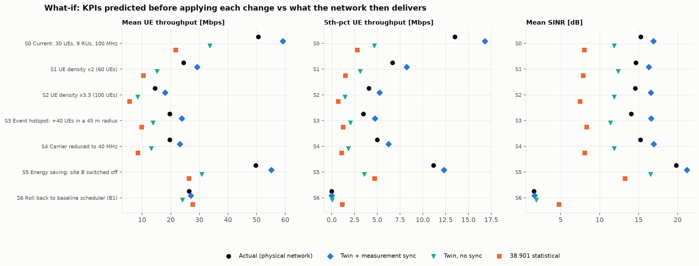

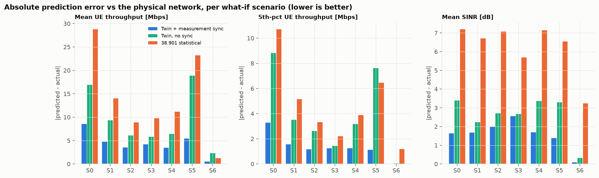

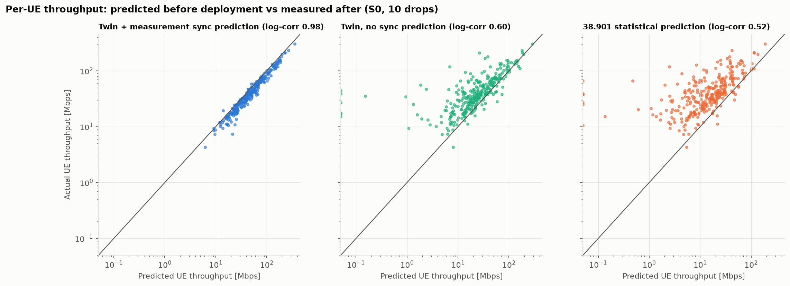

| Prediction accuracy | Twin + sync | Twin, no sync | 38.901 statistical |
|---|---|---|---|
| Error in predicted *change* of mean throughput (mean abs., percentage points) | **2.8** | 6.9 | 18.4 |
| Mean-throughput absolute error [Mbps], avg over scenarios | **4.3** | 10.2 | 14.1 |
| Per-UE throughput correlation (log scale) | **0.98** | 0.55 | 0.41 |
| Outage prediction, S0 (actual 0.0 %) | 0.0 % | 4.7 % | 5.7 % |

**Interpretation**

1. **The synced twin predicts the *effect* of a change very well** (within ~3 points). It is also
   the only predictor that gets *both* operational decisions right. Switching site B off costs
   little on this campus (−3 % mean, −21 % cell-edge throughput) because the other two sites cover
   its area in LOS; the twin predicts −7 % / −28 %. Rolling back to the baseline scheduler would
   halve throughput; the twin predicts −56 %.

   The 38.901 model gets **both directions wrong**: it says switching site B off *raises* mean
   throughput by 23 % (and cell-edge throughput by 155 %), and that the rollback *gains* 27 %. A
   statistical model cannot see the buildings and LOS geometry that make nearest-site association
   fail. These cases match TR 28.915 §5.1 (energy-saving policy verification) and §5.9
   (configuration verification).

2. **The absolute level is optimistic by ~15 %** (59.5 vs 51.5 Mbps in S0). The twin does not know
   the small-scale fading and unmodelled scatterers of the physical network, so its per-PRB SINR
   is too clean. The bias is consistent across scenarios, which is why *changes* are predicted
   well. A practical twin would learn a correction factor from history; a "same configuration
   today vs tomorrow" comparison cancels it.

3. **Per-UE predictions** (Fig. 14) line up along the diagonal for the synced twin
   (log-correlation 0.98). The other two predictors scatter widely. This per-UE accuracy is what
   enables UE-level decisions such as targeted handover or slice admission.

## 9. The twin as a 5G/6G NDT platform (Task 8)

### 9.1 Capabilities

**Sionna RT (used here)**
- Open source (Apache 2.0), Python, installs with `pip`.
- Scenes from Mitsuba XML, OpenStreetMap via Blender/Geo2SigMap (here: our own
  `tools/build_scene.py`), or built-in scenes.
- Specular reflection, diffuse scattering, refraction, wedge and edge diffraction.
- Custom antenna patterns and arrays, synthetic or real arrays, mobility via Doppler.
- Path-level CIR/CFR and radio maps (coverage, RSS, SINR); the whole ray tracer is differentiable.
- Works with PyTorch/TensorFlow/JAX, enabling gradient-based optimisation of RU positions,
  orientations and materials, plus learned calibration.

**NVIDIA AODT (the brief's suggested platform)**
- Everything above at larger scale (C++/CUDA EM solver), plus a full RAN digital twin: PHY/MAC
  with PDSCH/PUSCH, SRS channel estimation, SRS-based beamforming, 64T64R and MU-MIMO.
- DU–RU association and RU telemetry (throughput, MCS).
- GIS import with procedural indoor generation, UE mobility (from 1.5 also 3D/UAV waypoints).
- AI/ML examples (e.g. AI-based PUSCH channel estimation).
- A results database (raypaths, CIR/CFR, telemetry tables).
- From 1.5: headless/cloud-native operation, a fast EM mode, up to 40 M rays on an L40S,
  EM calibration from measured SS-RSRP traces, and a Python client.

### 9.2 Computational requirements (measured)

Hardware: Apple-silicon (M4) Mac CPU, no NVIDIA GPU (Mitsuba `llvm_ad_mono_polarized` backend).

Full IITGN study (`data/iitgn/build_log.json`):
- channel database ≈ 43 min (twin 405 s, twin at GPS positions 469 s, physical 1,724 s;
  1,650 UEs × 9 RUs, 1.4 × 10⁶ / 4.6 × 10⁶ rays per RU),
- coverage map 7 s,
- all allocation / mobility / what-if simulation on top of that.

A quick configuration (450 UEs, 10⁵ / 3 × 10⁵ rays per RU) builds the whole channel database in
under a minute, which is useful for checking code changes.

The runtime/memory scaling sweep (`experiments/e08_benchmark.py`, Fig. 15, `t8_*`) has **not yet
been run on the IITGN scene**. It writes to `results/iitgn/` and is expected to take well over
10 minutes on a CPU. Run it with `python experiments/e08_benchmark.py`. On small machines, receivers
must be traced in batches (the twin uses batches of 200 UEs), otherwise memory runs out.

AODT, by contrast, needs:
- a supported NVIDIA GPU (SM 8.0–9.0, i.e. Ampere, Ada or Hopper; NVIDIA's own figures quote L40S-class cards),
- Ubuntu with Docker/Kubernetes for the backend and a results database,
- an NGC key and 6G Developer Program access.

The cloud installers (AWS/Azure) are the realistic route for a student team.

### 9.3 Limitations observed

1. **Scene fidelity is the ceiling.** OpenStreetMap geometry has no trees, terrain, vehicles,
   street furniture or interiors, and 72 % of campus building heights are an assumed 12 m.
   Material parameters are ITU defaults. Our physical stand-in (different materials, deeper
   tracing, shadowing, fading, position error) changed one best server in four.
2. **No vegetation.** The campus is heavily wooded. Real foliage would block some of the LOS links,
   reducing interference, improving B1 and shrinking the twin gain. The gains here are best read as
   an upper bound for this site.
3. **Weak traced links.** Depth-limited tracing resolves 99.5 % of links here, but some resolved
   links are unrealistically weak and are not replaced by the 38.901 fill. This mostly penalises
   the baseline (§7).
4. **Positioning.** Without accurate UE positions, site-specific channels are looked up at the
   wrong place; 5 m GPS error lowered the unsynchronised twin's T3 throughput by a further 9 %.
5. **No small-scale truth.** A deterministic twin predicts a smooth channel. Fading must be added
   statistically, which causes the ~15 % optimism in §8.
6. **Synchronisation and calibration** need a data pipeline from the live network (measurement
   reports, MDT, RSRP traces). Without it the twin keeps only part of its value (§6.3).
7. **Compute vs freshness.** On CPU a full retrace takes tens of minutes, too slow for per-slot
   decisions. Practical use is slower loops: association and coordination policies (seconds to
   minutes), planning and what-if (hours). GPUs bring retracing to seconds.
8. **Abstraction level of this study.** SISO-equivalent, downlink, full buffer, effective-SINR
   link abstraction. AODT's full PHY/MAC would remove the abstraction for MIMO/beamforming studies.
9. **The "physical network" is a higher-fidelity simulation**, not measurements.

### 9.4 Research problems this platform is suited for

- **Site-specific RRM:** association, load balancing, CoMP / coordinated scheduling and
  interference management, as here.
- **Beam management** at FR1 massive MIMO and FR2/FR3 (6G upper mid-band 7–24 GHz): beam
  prediction from position, blockage prediction.
- **Mobility robustness:** handover parameter (offset/TTT) tuning per location, conditional
  handover, ping-pong analysis.
- **Energy saving:** cell/carrier switch-off verification (TR 28.915 §5.1), RU sleep scheduling.
- **Network planning and what-if:** RU placement, tilt/azimuth optimisation (Sionna is
  differentiable), new-site evaluation, event planning.
- **Twin calibration:** learning materials and scene corrections from MDT/RSRP traces;
  quantifying the sim-to-real gap (as in §6.3).
- **AI-RAN / ML training data** (TR 28.915 §5.6): site-specific CSI datasets for channel
  estimation, CSI compression, positioning, and O-RAN xApp/rApp testing.
- **6G topics:** RIS placement, ISAC (sensing from multipath), UAV/NTN coverage in 3D, and
  digital-twin-native closed-loop automation.

## 10. Site-placement what-if: rooftop masts vs ground towers

The site layout itself is a what-if: *what happens if we move the masts?* We ran the whole study
twice, with two gNB layouts.

### 10.1 Two site layouts

| | Layout 1: rooftop-centre masts | Layout 2: 30 m ground towers (used in §3–8) |
|---|---|---|
| Site A | Indoor Sports Complex roof, mast 20 m (roof 12 m) | 10 m north of the Sports Complex wall, 30 m |
| Site B | Academic Block 12 roof, mast 28.1 m (roof 24.1 m) | 15 m east of Academic Block 12, 30 m |
| Site C | Kyzeel Hostel roof, mast 24 m (roof 20 m) | 10 m south of Kyzeel Hostel, 30 m |
| Sectors | 0° / 120° / 240° at every site | Rotated per site so the host building lies between two sectors |
| Results | `results/iitgn_rooftop_centre/` | `results/iitgn/` |

Layout 1 used the scene builder's suggestion: a mast at the centre of a tall roof. Site A was moved
by hand from a small housing block to the Sports Complex. The tall academic blocks and hostels all lie
within 100 m of sites B or C, so they could not host it without clustering two sites together.

**Why layout 2.** Layout 1 gave a surprising result: 47 % of users were best served by a site
other than the nearest one. Checking the geometry showed that each mast, standing only 4–8 m above
the middle of a wide roof, was **shadowed by its own roof edge**. Within 100 m of the masts, 60 of
65 users (92 %) had no line of sight to their own site, and in 58 of these cases the blocker was
the host roof (Fig. 17). The geometric shadow radius was about 110–125 m. Raising the masts would
not fix this realistically: halving the shadow would need masts about 11 m taller on B and C, and
54 m in total on the Sports Complex. Layout 2 therefore puts 30 m towers on open ground 10–15 m
outside each host building. Each tower stands at the spot (on a 10–15 m band around the building,
at least 10 m from any other building) that has 3-D line of sight to the most users within 300 m.
Its sectors point away from the host wall. Per-site sector azimuths are an optional
`sector_azimuths_deg` entry for each site in the config.


*Layout 2: new towers (▲) vs the old rooftop masts (×), with each tower's sector directions.*

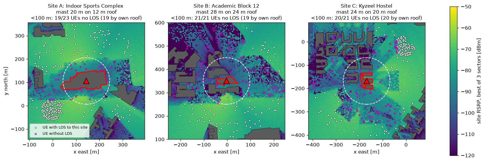

*Fig. 17: Layout 1, best-sector RSRP around each rooftop mast. Inside the dashed 100 m circle,
almost no user (× = no LOS) can see the mast past its own roof edge.*

### 10.2 Results

Values with ± are 95 % confidence intervals over the Monte Carlo drops (§6).

| | Layout 1: rooftop-centre masts | Layout 2: 30 m ground towers |
|:--|:--|:--|
| Best site is not the nearest [% users] | 47 | 41 |
| LOS links [%] | 57 | 68 |
| Users < 100 m from a site with no LOS to it | 60 / 65 (92 %) | 4 / 68 (6 %) |
| Median best-server RSRP [dBm] | −79 | −77 |
| Median SINR [dB] | 4.4 | 3.9 |
| B1 mean throughput [Mbps] | 19.3 ± 1.7 | 23.3 ± 2.2 |
| B1 5th-pct throughput [Mbps] | 0.0 | 0.0 |
| B1 outage [%] | 28.7 ± 2.8 | 22.7 ± 2.8 |
| T3 mean throughput [Mbps] | 55.5 ± 2.3 | 55.3 ± 2.5 |
| T3 5th-pct throughput [Mbps] | 15.5 ± 1.5 | 15.1 ± 1.4 |
| T3 outage [%] | 0.1 ± 0.2 | 0.2 ± 0.3 |
| **T3 gain over B1, mean throughput** | **+188 %** | **+137 %** |
| What-if: twin per-UE correlation (synchronised) | 0.98 | 0.98 |
| What-if: twin error in predicted change [pp] | 2.8 | 2.8 |
| What-if: TR 38.901 model per-UE correlation | 0.37 | 0.41 |
| What-if: TR 38.901 error in predicted change [pp] | 31.6 | 18.4 |
| Ray-tracing time, CPU (twin + noisy twin + physical) | 47 min | 43 min |

**The campus is interference-limited.** With low, scattered buildings, most UEs see their own
site *and* the neighbouring sites (57–68 % LOS links). Signals are strong (median RSRP −79 / −77 dBm),
but so is inter-cell interference, so median SINR is only about 4 dB. Distance is a poor guide to
the best server, and the nearest-site baseline B1 suffers from both wrong association and
full-reuse interference.

**Twin-assisted allocation reaches the same level regardless of the layout.** T3 achieves about
55 Mbps mean and 15 Mbps at the 5th percentile in both layouts, with essentially no outage. It knows
which site each UE really sees and mutes the PRBs that cause the most interference (about 68 % PRB
utilisation). On an open campus nearly every location has *some* clear path to a site.

**Moving the masts helps the baseline, not the twin.** The towers removed the rooftop shadow
(no-LOS users near a site: 92 % → 6 %). The share of users for whom the nearest site is wrong
fell from 47 % to 41 %. B1 gained about 4 Mbps mean and about 6 points of outage; both changes
sit at the edge of the confidence intervals. T3 did not change. The apparent twin gain therefore
fell from +188 % to +137 %: part of the layout-1 gain was the twin compensating for a poor
mast placement. That is useful in itself, because a twin that exposes such a placement error is
worth having before deployment. But it means **the twin's gain should be quoted against a sensibly
planned baseline**. The remaining 41 % is genuine. 57–58 % of the UEs are more than 300 m from every
site (the box is mostly open land around a compact campus). There, two sites are often almost
equally far away, and the antenna pattern or a single building decides which one is stronger.

**What-if prediction.** The synchronised twin predicts the six what-if scenarios equally well in
both layouts (2.8 pp mean error). The TR 38.901 model, built for typical urban streets, fits the
open campus poorly (per-UE correlation 0.37–0.41). Its error in the predicted change varies a lot
between the two runs (31.6 vs 18.4 pp). That suggests its accuracy depends strongly on the
particular UE drop, not just the site.

### 10.3 Caveats specific to the campus

1. **No vegetation** (see §9.3).
2. **Building heights are mostly assumed.** 72 % of the buildings, including the Sports Complex,
   use the 12 m default. Several kiosks under 30 m² become 12 m blocks.
3. **The two layouts use different random UE pools.** The cached positions were deliberately cleared
   before the layout-2 run, so the comparison includes drop-to-drop randomness. The mobility walks
   (Task 5) were also redrawn, so their handover counts are not compared between layouts.
4. **Site placement is a heuristic** (most users in 3-D LOS within 300 m), not an optimisation.
   In layout 2, sites A and B ended up only 210 m apart. A proper placement study, for example
   with Sionna's differentiable ray tracing (§9.4), is future work.

## 11. Conclusions

- A ray-traced twin of the IIT Gandhinagar campus shows that on an open, low-rise site,
  geometry-based allocation picks the wrong site for about 41 % of locations and suffers from
  strong inter-cell interference. Twin-assisted association, scheduling and interference
  coordination raise mean throughput by 137 %, lift cell-edge throughput from zero to 15 Mbps,
  and remove almost all outage.
- These gains hold on a different physical network **only if the twin is synchronised with
  network measurements**. An unsynchronised twin keeps only part of the gain and is not a safe
  basis for fine-grained decisions.
- With synchronisation, the twin predicts the effect of what-if changes within about 3
  percentage points and gets the operational decisions right, where a standard statistical model
  gets their direction wrong.
- The twin also exposed a poor mast placement (rooftop-centre masts shadowed by their own roofs).
  Gains should be quoted against a sensibly planned baseline.

**Future work**
- Add vegetation and terrain to the scene, and measured building heights.
- Run the same pipeline on AODT with MIMO/beamforming.
- Learn the fading/optimism correction from data.
- Close the loop with real MDT traces or an OpenAirInterface/Sionna Research Kit testbed.

## Reproducing

```bash
pip install -r requirements.txt
python run_all.py --skip-bench            # IITGN study, results in results/iitgn/ (≈ 45 min ray tracing on an Apple-silicon Mac CPU)
python run_all.py --skip-build --skip-bench   # reuse the ray-traced channel database in data/iitgn/
python experiments/e08_benchmark.py       # Task 8 runtime sweep (long; not yet run for IITGN)
python tools/export_3d.py                 # interactive 3D view: results/iitgn/twin_3d.html
```

Layout 1 (rooftop-centre masts) results and the config that produced them are kept in
`results/iitgn_rooftop_centre/` (`iitgn_config_used.yaml`).

| Deliverable | Location (under `results/iitgn/`) |
|---|---|
| Scenario & parameter table | Fig. 1, `tables/t1_parameters.csv` |
| Channel database & RAN measurements | `tables/t2_*.csv`, `data/iitgn/*.npz`, Figs 2–5 |
| Baseline & channel-aware allocation | `dt/alloc.py`, Figs 6, 9 |
| Mobility | Figs 10–11, `tables/t5_*.csv` |
| KPI comparison | Figs 7–8, 16, `tables/t6_*.csv` |
| What-if | Figs 12–14, `tables/t7_*.csv`; site layouts: §10 |
| Platform evaluation | §9 (Fig. 15 / `t8_*.csv` after running e08) |

## References

1. 3GPP TR 28.915 V19.0.0, *Study on management aspects of Network Digital Twin*, 2025.
2. Hoydis et al., *Sionna RT: Technical Report*, arXiv:2504.21719, 2025.
3. NVIDIA, *Aerial Omniverse Digital Twin documentation* (installation, release notes 1.1–1.5).
4. *Better Together: Leveraging Multiple Digital Twins for Deployment Optimization of Airborne
   Base Stations* (Sionna RT and AODT comparison), arXiv:2508.15816, 2025.
5. 3GPP TR 38.901 (channel model), TS 38.214 (CQI tables), TS 38.306 (peak-rate formula),
   TS 38.101-1 (PRB counts).
