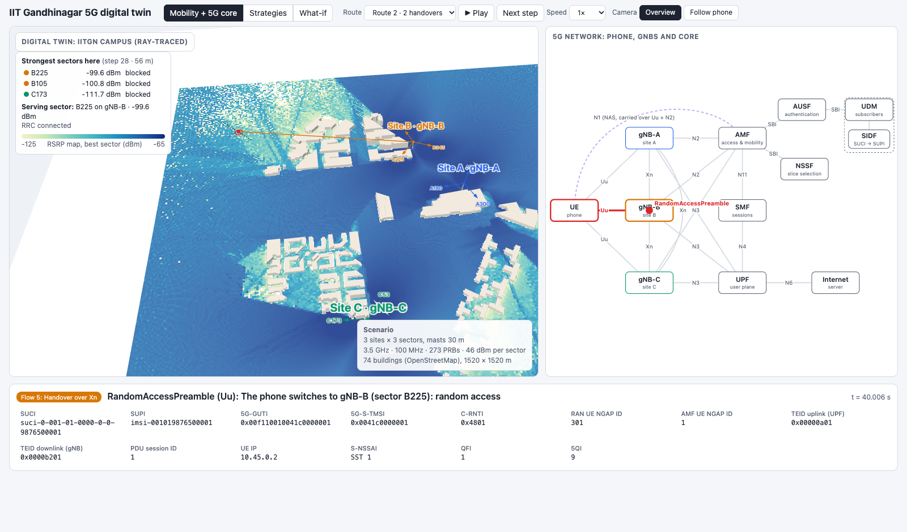
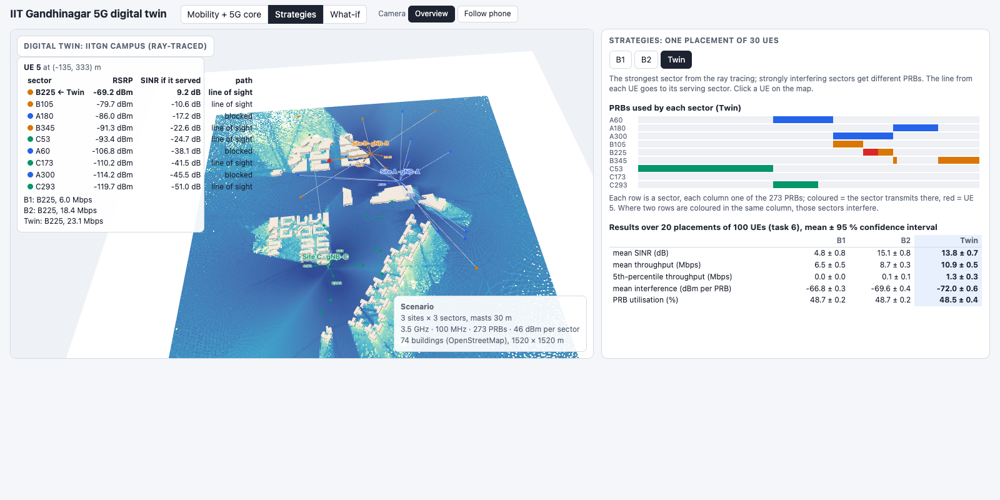
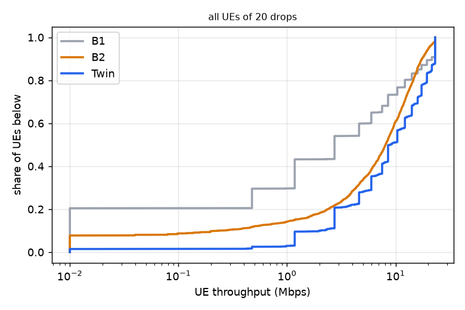
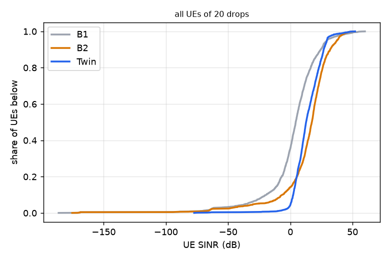
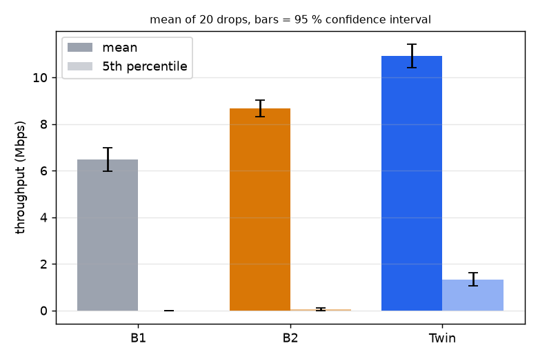
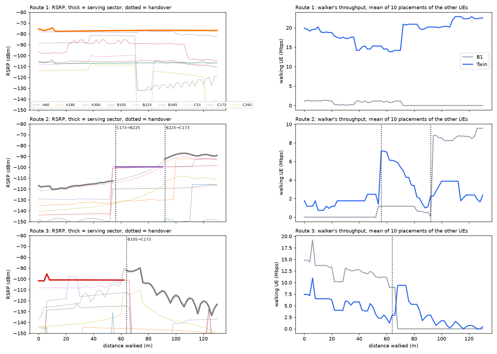
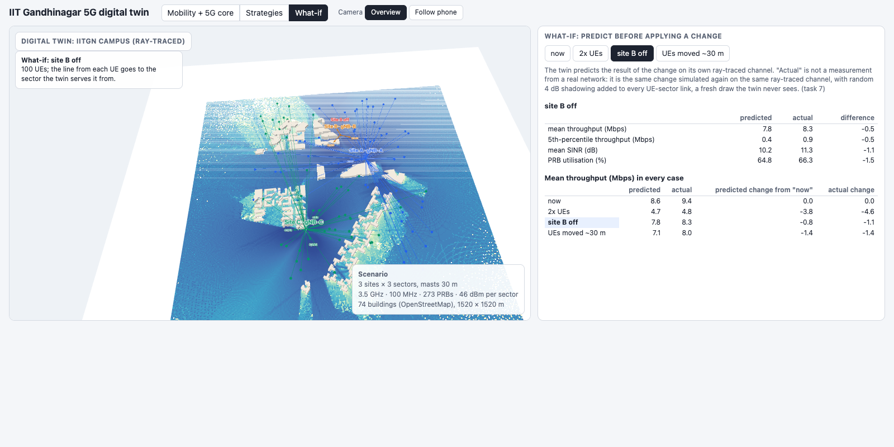

# A 5G digital twin of the IIT Gandhinagar campus

*Course project, 5G and Beyond, IIT Gandhinagar, Semester I 2026. Draft.*

## Abstract

We built a computer copy (a "digital twin") of a 5G network on the IIT Gandhinagar campus. It has 3 sites
with 3 antennas each, on real building shapes from OpenStreetMap. A ray tracer works out how strong the radio
signal is everywhere on campus. With these signals we compared three ways of sharing radio resources between
100 phones. The twin-based way gave the highest average speed (10.9 Mbps, against 6.5 and 8.7 Mbps), and it was
the only one where even the weakest phones got some data. We also walked a phone along three routes, showed
the 5G messages it exchanges, and used the twin to predict the effect of changes before making them.

---

## 1. Introduction

**Why not test on the real network?** A mobile operator cannot easily try out a new idea on a live network:
customers would suffer if it went wrong, and every test takes time and people. A *digital twin* is a computer
model of the network that is detailed enough to try ideas on first. If an idea works on the twin, it is worth
trying for real.

**What we wanted to find out:**
- Can a twin built from free map data and a ray tracer tell a network *which antenna should serve each phone*
  and *which radio resources it should use*, better than simple rules can?
- Can it predict what happens when something changes (more users, an antenna switched off, users moving)?
- Can it show, step by step, the 5G messages a phone exchanges as it moves (the flows taught in class)?

**Where this fits.** 3GPP, the body that writes the 5G standards, describes this idea in its study on network
digital twins (TR 28.915): a model of the network that is kept close to the real one and is used to analyse
and test changes safely.

---

## 2. System overview

The project is a pipeline. Each stage uses the output of the one before it:

```
 OpenStreetMap buildings ──► 1. Campus scene (3 sites × 3 sectors)
                                  │
                                  ▼
                             2. Ray tracing: signal from every sector to every phone position
                                  │
                                  ▼
                             3. Allocation: who serves each phone, which radio resources it gets
                                  │                                   (B1, B2 and Twin)
                                  ▼
                             4. KPIs: speed, signal quality, interference, resource use
                                  │
                ┌─────────────────┼──────────────────┐
                ▼                 ▼                  ▼
     5. Moving phone      6. 5G core flow      7. What-if: predict a change,
        (handovers)          (messages, IDs)       then compare with a re-run
```

*Figure 1: The pipeline, from map data to results.*

Everything runs on a laptop. The ray tracing (stage 2) is the slow part; all the other stages take seconds.
The results feed a single web page, `twin.html`, which shows the campus in 3D next to the 5G network
(Figure 2).



*Figure 2: The demo page. Left: the 3D campus, coloured by signal strength. The red dot is a phone walking a
route, and the orange line goes to the antenna serving it. Right: the 5G network, with the current message
moving along its link. Bottom: what is happening now, and the phone's identities.*

---

## 3. Building the campus twin

**The buildings.** The campus buildings come from OpenStreetMap, a free world map that includes building
outlines and, for some buildings, their heights. They were turned into 3D blocks: 74 buildings in a square of
1520 m × 1520 m, the tallest about 24 m high. The building walls are modelled as concrete and the ground as
dry soil. These materials decide how much signal is reflected or absorbed.

**Sites and sectors.** A *site* is a mast with antennas. Each of our 3 sites (A, B and C) carries 3 *sectors*:
antennas that each point in a different direction and cover one third of the circle around the mast. That makes
9 sectors in total. Each site acts as one *gNB*, the 5G name for a base station. A sector is named after its
site and direction: "B225" is site B's sector pointing at 225° (south-west).

**Why the masts are next to buildings, not on their roofs.** In an earlier version the masts stood in the
middle of building roofs. The roof edge then blocked the signal from reaching the ground close to the
building. So each mast now stands on the ground, 10–15 m outside its host building, and is 30 m tall. That is
taller than any campus building, so it sees over the roofs.

**Radio settings.** Each sector transmits a fixed power over a 100 MHz wide channel. The channel is split into
273 *physical resource blocks* (PRBs). A PRB is the smallest piece of spectrum the network can hand to a phone:
here, 360 kHz wide.

| Setting | Value |
|---|---|
| Frequency band | 3.5 GHz (5G band n78) |
| Bandwidth | 100 MHz, split into 273 PRBs |
| Transmit power | 46 dBm per sector (about 40 W) |
| Mast height | 30 m, all three sites |
| Sector antenna | standard 3GPP pattern (TR 38.901), tilted 8° down |
| Phone (UE) | 1.5 m above ground, same gain in every direction, 9 dB noise figure |
| Site positions (m, east / north of centre) | A (174, 158), B (59, 334), C (−148, −216) |

*Table 1: Radio and site settings.*

---

## 4. Channel information and measurements

**Ray tracing.** A *ray tracer* (here, Sionna RT) sends millions of imaginary rays out of each antenna. It
follows each one as it bounces off walls and the ground (up to 3 times) and bends around building edges
(diffraction). It then adds up everything that reaches each phone position. We used 1 000 000 rays per sector.

**What we measure.** We placed 100 *UEs* ("user equipment", meaning phones) at random outdoor spots around the
three sites. For every phone and every sector we computed four things:

- **RSRP** (reference signal received power): how strong a sector's signal is at the phone, in dBm. −70 dBm
  is strong, −110 dBm is weak.
- **SINR** (signal to interference plus noise ratio): how much stronger the wanted signal is than everything
  else the phone hears. That includes the other sectors (*interference*) and the receiver's own *noise*. It
  is measured in dB; higher means a cleaner signal and a faster connection.
- **Line of sight (LOS):** whether the straight line from the antenna to the phone is free of buildings.
- **Path loss:** how much weaker the signal is on arrival than when it left the antenna.

**Results** (100 phones × 9 sectors = 900 links, traced in 17 seconds):

- **Line of sight:** 61 % of all links are in line of sight. For each phone's *strongest* sector it is 75 %.
  So most phones can see at least one antenna directly, but a quarter cannot.
- **Strongest sector's RSRP:** a median of −75.2 dBm (half the phones are above this, half below). That is a
  good signal level.
- **No path:** 5 of the 900 links have no ray path at all. Those phones are hidden from that sector.
- **SINR with every sector transmitting everywhere:** a median of only 3.6 dB at the strongest sector. On
  this campus, interference is a bigger problem than weak signal. That is why the way resources are shared
  matters so much (Section 5).

To get fair averages, we traced **20 different random placements** of 100 phones (2000 phone positions in
all).



*Figure 3: Measurements for one phone (UE 5, top left). For each of the 9 sectors: its RSRP, the SINR the phone
would get if that sector served it, and whether there is line of sight. The map shows 30 phones, each joined
to the sector that serves it.*

---

## 5. Allocation strategies

*Allocation* means two decisions for every phone:
- **which sector serves it,** and
- **which PRBs it gets.**

In our model each phone asks for 12 PRBs. A sector therefore uses only as many PRBs as its phones need (on
average about half of its 273). Two sectors that use the *same* PRB interfere with each other's phones on that
PRB, so the choice of PRBs decides who disturbs whom.

We compare three strategies:

- **B1, fixed:** each phone is served by the nearest site, using that site's sector that points towards the
  phone. In every sector, the first phone gets PRBs 1–12, the second 13–24, and so on. This uses only a map, no
  radio knowledge. Because every sector counts from the same start, neighbouring sectors always land on the
  same PRBs.
- **B2, random:** the same choice of sector as B1, but each sector picks its PRBs at random.
- **Twin:** uses the ray-traced signals in two ways:
  1. **The right sector:** each phone is served by the sector whose signal is *actually* strongest where it
     stands. That is not always the nearest one, because buildings get in the way.
  2. **Different PRBs for neighbours that clash:** from the ray tracing, the twin estimates how strongly each
     pair of sectors disturbs each other's phones. The busiest sector picks its PRBs first. Each following
     sector picks the PRBs that its worst-clashing neighbours are *not* using.

**A small example** (one placement, from the page in Figure 3):
- **Phone 3** stands at (−278, 261) m. B1 serves it from sector B225, the nearest site, but a building blocks
  the line of sight and the signal is −88.6 dBm: it gets **0 Mbps**. The Twin serves it from sector A180, which
  it can see directly at −75.4 dBm (13 dB stronger): it gets **23.1 Mbps**, the most any phone can get here.
- **Phone 5** is served by the same sector (B225) in all three strategies, so only its PRBs differ. It gets
  6.0 Mbps with B1, 18.4 Mbps with B2 and 23.1 Mbps with the Twin. With the Twin's PRBs, hardly any other
  sector transmits on its PRBs.

**How each step of the twin helps** (one placement of 100 phones):

| Strategy | Mean speed | Speed of the weakest 5 % |
|---|---|---|
| B1 | 4.29 Mbps | 0.00 Mbps |
| Twin step 1 only (right sector, fixed PRBs) | 5.93 Mbps | 0.47 Mbps |
| Twin step 2 only (nearest site, clash-avoiding PRBs) | 7.55 Mbps | 0.00 Mbps |
| Twin (both steps) | **8.55 Mbps** | **0.98 Mbps** |

*Table 2: Each part of the twin strategy on its own, then together.*

Both steps help, and they help in different ways:
- **Choosing the right sector** mostly helps the weakest phones. 44 of the 100 phones move to another sector,
  whose signal is 8.8 dB stronger for the median phone.
- **Avoiding clashing PRBs** mostly raises the average speed.

Only the two together lift both the average and the weakest phones.

---

## 6. Results: comparing the strategies

We ran all three strategies on the same 20 random placements of 100 phones. Below, each number is the average
over the 20 placements, ± its *95 % confidence interval*: the range in which the true average lies with 95 %
certainty, given that we only tried 20 placements.

| | B1 (fixed) | B2 (random) | Twin |
|---|---|---|---|
| Mean speed per phone (Mbps) | 6.48 ± 0.50 | 8.67 ± 0.35 | **10.92 ± 0.50** |
| Speed of the weakest 5 % (Mbps) | 0.00 ± 0.00 | 0.05 ± 0.05 | **1.33 ± 0.29** |
| Mean SINR (dB) | 4.85 ± 0.81 | **15.12 ± 0.81** | 13.85 ± 0.66 |
| Mean interference (dBm per PRB) | −66.84 ± 0.35 | −69.57 ± 0.38 | **−71.98 ± 0.55** |
| PRB use (%) | 48.74 ± 0.22 | 48.74 ± 0.22 | 48.49 ± 0.38 |

*Table 3: The three strategies compared, mean of 20 placements of 100 phones ± 95 % interval.*

**What these numbers mean:**

- **Speed.** The Twin gives each phone 10.9 Mbps on average, 68 % more than B1 and 26 % more than B2. The
  intervals don't overlap, so the difference is real, not luck.
- **The weakest phones.** The weakest 5 % of phones are the most telling result. With B1 they get nothing at
  all, and with B2 almost nothing. With the Twin they get 1.3 Mbps: still slow, but enough to stay connected.
- **SINR.** B2 has a slightly *higher* mean SINR than the Twin, yet a lower speed. Random PRBs leave a few
  phones almost free of interference, which pushes the average SINR up, but many other phones are left with a
  poor signal. The Twin gives more phones a usable signal, and speed depends on that.
- **Interference.** It is lowest with the Twin (−72.0 dBm per PRB). That is what avoiding clashing PRBs is
  meant to do.
- **PRB use.** It is the same for all three (about 49 %), because every phone asks for the same 12 PRBs. The
  Twin's gain comes from using the spectrum better, not from using more of it.

**Why the speeds are around 6–11 Mbps.** A sector serves about 10–11 phones, and each phone gets the 12 PRBs it
asks for. Even with a perfect signal, 12 PRBs carry at most 23.1 Mbps. A typical phone's SINR is 4.3 dB with B1
and 12.6 dB with the Twin. That is worth about 0.23 and 0.86 Mbps per PRB, so about 2.7 and 10.4 Mbps for
12 PRBs. These match the measured *medians* (2.7 and 8.9 Mbps). The means are a little higher because a few
phones with a clean signal reach the 23.1 Mbps limit.



*Figure 4: Speed of every phone in all 20 placements. Each line shows the share of phones (up the side) whose
speed is below a value (along the bottom). A line further right is better. Where a line starts on the left
shows the share of phones that get nothing: about 20 % with B1, about 8 % with B2, and under 2 % with the
Twin.*



*Figure 5: SINR of every phone, shown the same way. B1's phones have much lower SINR than the other two.*



*Figure 6: Mean speed (solid) and speed of the weakest 5 % (light), with their 95 % intervals.*

---

## 7. Moving the phone

**Routes.** We walked a phone along three routes, each 130 m long, stopping every 2 m (66 stops). At every
stop we ray-traced the signal of all 9 sectors.

**Handover.** When a phone moves, another sector may become stronger, and the network then moves the phone to
it: a *handover*. We used the common *A3 rule*: hand over when another sector is more than 3 dB stronger than
the current one for 2 stops in a row. Waiting 2 stops (*hysteresis*) stops the phone from bouncing back and
forth.

| Route | Handovers |
|---|---|
| 1 | none |
| 2 | 2: from C173 to B225 at 56 m, then back to C173 at 92 m |
| 3 | 1: from B105 to C173 at 64 m |

*Table 4: Where the walking phone changes sector.*

**Speed while walking.** At every stop we put the walking phone among 100 other phones and ran B1 and the Twin.
To be fair, the walking phone is treated like any other phone: it gets a random place in the list of phones,
and the same rules for PRBs. We repeated this for 10 different placements of the other 100 phones and averaged.

| Route | B1: mean speed | B1: stops at 0 Mbps | Twin: mean speed | Twin: stops at 0 Mbps |
|---|---|---|---|---|
| 1 | 0.5 ± 0.6 Mbps | 76 % | **18.8 ± 3.2 Mbps** | **0 %** |
| 2 | 2.8 ± 1.7 Mbps | 50 % | 2.7 ± 0.3 Mbps | **0 %** |
| 3 | **6.4 ± 1.8 Mbps** | 50 % | 3.9 ± 1.5 Mbps | **6.5 %** |

*Table 5: The walking phone's speed (mean of 10 placements ± 95 % interval) and how often it gets nothing.*

**What this shows:**
- **The Twin keeps the phone connected.** With B1, the phone gets no data at half or more of the stops on every
  route. With the Twin it almost never loses its connection (0 %, 0 % and 6.5 %).
- **The average speed is a different story.** The Twin is far ahead on route 1, level on route 2, and **behind
  B1 on route 3**.

**Why B1 wins on route 3.** The route has two halves.
- **First half:** both strategies serve the phone from sector B105, with the same signal (−100.9 dBm). But
  with B1, the phone's fixed PRBs usually lie where few other sectors transmit. It hears almost no
  interference (−130.6 dBm) and averages 12.5 Mbps.
  With the Twin, B105's PRBs are chosen to protect B105's *typical* phones, not this phone at the edge of its
  area. So a neighbouring sector still disturbs it (−97.3 dBm), and it averages only 5.2 Mbps.
- **Second half:** B105's signal fades to −151.7 dBm. B1 stays on B105 and gets nothing on 96 % of stops
  (0.5 Mbps). The Twin hands over to C173 (−116.5 dBm) and keeps 2.8 Mbps.
- **Overall:** the Twin's loss in the first half is larger than its gain in the second.

The handover rule hardly matters here: when the Twin is not on the strongest sector, it is only 1.1 dB below
it. Nor does the number of phones in the sector: the phone gets its 12 PRBs either way.



*Figure 7: The three routes. Left: the signal of each sector along the route. The thick line is the serving
sector, and dotted lines mark handovers. Right: the walking phone's speed with B1 (grey) and the Twin (blue),
averaged over 10 placements.*

---

## 8. The end-to-end 5G flow

The web page plays, message by message, what happens in the 5G network while the phone walks a route. It
follows the flows taught in class.

**The network parts:**

| Part | What it does |
|---|---|
| **UE** | the phone |
| **gNB** | the base station: one per site (A, B, C) |
| **AMF** | handles sign-in and tracks where the phone is |
| **AUSF** | checks the phone's identity |
| **UDM** | the subscriber database |
| **SIDF** | part of the UDM: turns the hidden identity back into the real one |
| **NSSF** | picks the network "slice" (type of service) |
| **SMF** | sets up data sessions |
| **UPF** | forwards the data to and from the internet |

The links between them are named *interfaces*:

| Interface | Between |
|---|---|
| Uu | the radio link, phone to gNB |
| N1 | the phone and the AMF, carried inside the others |
| N2 | the gNB and the AMF |
| N3 | the gNB and the UPF |
| N4 | the SMF and the UPF |
| N6 | the UPF and the internet |
| N11 | the AMF and the SMF |
| Xn | gNB to gNB |

**The flows, in order:**

1. **Switching on.** The phone listens to the gNB's broadcast signals (SSB, MIB, SIB1). It then does
   *random access* to get a temporary radio identity (the C-RNTI), and sets up a radio connection (RRC).
2. **Registration.**
   - The phone sends its hidden identity (SUCI) to the AMF.
   - The SIDF inside the UDM recovers the real identity (SUPI).
   - The phone and network check each other (authentication) and switch on security. Only then does the phone
     send its device ID (IMEISV).
   - The AMF gives the phone a temporary identity (5G-GUTI) to use from now on.
3. **Data session (PDU session).** The SMF gives the phone an IP address and sets up a tunnel between the gNB
   and the UPF. Each end of the tunnel has a number, its TEID.
4. **Data.** Requests and replies travel phone → gNB → (N3 tunnel) → UPF → internet, and back.
5. **Handover over Xn.** When the twin's A3 rule picks a sector on *another site*, the old gNB hands the phone
   to the new one over Xn. The UPF then switches the data tunnel to the new gNB.
   One handover takes 15 messages.
6. **Idle and paging.** After the walk, with no data for 10 seconds, the phone goes *idle*: it keeps its
   identities but drops its radio connection. When a message arrives for it, the UPF holds the message, and
   the AMF *pages* the phone through all gNBs. The phone answers with a Service Request carrying its short ID
   (5G-S-TMSI), and the held message is delivered.

On route 2 this adds up to 190 messages, including the 2 handovers. An automatic test (`test_flows.py`)
checks:
- that each flow's messages come in the taught order;
- that the handovers happen at the same places as in Section 7;
- that the real identity (SUPI) is never sent over the radio.

**Identities used** (example values from the page):

| Identity | Example | What it is |
|---|---|---|
| SUPI | imsi-001019876500001 | the subscriber's permanent identity; never sent over the radio |
| SUCI | suci-0-001-01-0000-0-0-9876500001 | the SUPI as sent by the phone (the "null scheme", so not encrypted, as in class) |
| 5G-GUTI | 0x00f110010041c0000001 | temporary identity given by the AMF |
| 5G-S-TMSI | 0x0041c0000001 | short form of the 5G-GUTI, used in paging |
| C-RNTI | e.g. 0x4801 | the phone's radio identity at one gNB; changes at every handover |
| RAN / AMF UE NGAP ID | e.g. 301 / 1 | how the gNB and AMF refer to the phone between them |
| TEID | e.g. 0x00000a01 (UPF side) | the number of each end of the data tunnel |
| PDU session ID, UE IP | 1, 10.45.0.2 | the data session and the phone's IP address |
| S-NSSAI, QFI, 5QI | SST 1, 1, 9 | slice type, quality-of-service flow and its class |

*Table 6: The 5G identities shown on the page.*

**What comes from the ray tracing, and what is assumed.**
- **From the ray tracing:** the signal of every sector along the route, and so where the handovers happen.
- **Assumed:** the message delays, the identity values, the security values (placeholders, no real
  encryption), and when data is sent.

---

## 9. What-if analysis

**The idea.** Before changing the network, ask the twin "what would happen if…?" Then make the change and
compare.

**The scenarios** (all with the Twin strategy, 100 phones):
- **now:** the network as it is, for reference;
- **2× UEs:** twice as many phones (200);
- **site B off:** site B switched off;
- **UEs moved ~30 m:** every phone moved about 30 m.

**What "actual" means here.** "Actual" is not a measurement from a real network: it is the same change
simulated again on the same ray-traced channel, with random 4 dB shadowing added to every UE-sector link, a
fresh draw the twin never sees. *Shadowing* is the random extra loss real signals suffer from things the model
doesn't include, such as trees, vehicles and people.

| Scenario | Mean speed: predicted / actual | Weakest 5 %: predicted / actual | Mean SINR: predicted / actual |
|---|---|---|---|
| now | 8.55 / 9.39 Mbps | 0.98 / 0.77 Mbps | 10.7 / 13.4 dB |
| 2× UEs | 4.72 / 4.77 Mbps | 0.49 / 0.48 Mbps | 6.7 / 6.5 dB |
| site B off | 7.80 / 8.26 Mbps | 0.39 / 0.86 Mbps | 10.2 / 11.3 dB |
| UEs moved ~30 m | 7.11 / 7.97 Mbps | 0.98 / 1.17 Mbps | 9.2 / 10.6 dB |

*Table 7: The twin's prediction against the re-run with random shadowing.*

**What these numbers mean:**
- **Speed:** the twin predicts the mean speed within 0.85 Mbps in every case, and it gets the direction of
  every change right:
  - twice the phones halves the speed;
  - switching off site B costs about 0.8 Mbps;
  - moving the phones costs about 1.4 Mbps.
- **SINR:** the predictions are less close, up to 2.6 dB off. The twin plans PRBs using its own exact signals,
  but they are then tested on the shadowed ones.
- **The "actual" values are slightly optimistic.** Shadowing that averages zero dB still raises the average
  received power a little. On top of that, each phone ends up on whichever of its 9 sectors came out
  strongest after the random shadowing.



*Figure 8: The What-if tab for "site B off": predicted against actual, the change from "now", and the map with
each phone joined to its serving sector.*

---

## 10. Platform: capabilities, cost, limitations and research problems

[Written by me]

**Measured facts:**

| Fact | Value |
|---|---|
| Computer | Apple M4 laptop, 10 CPU cores, 16 GB memory, macOS 26.5.2 |
| Ray tracer runs on | the CPU (LLVM); no GPU used |
| Software | Python 3.14.7, Sionna RT 2.2.0, Mitsuba 3.9.1, Dr.Jit 1.5.0, NumPy 2.5.4, Matplotlib 3.11.2, three.js r128 |
| Scene | 1520 m × 1520 m × 24 m, 74 buildings (3768 triangles), 9 sectors |
| Ray-tracing settings | up to 3 reflections, diffraction on |
| Scene load time | 0.4–0.6 s |
| Trace 25 / 50 / 100 / 200 / 400 phones (1 M rays per sector) | 5.3 / 9.5 / 17.6 / 42.5 / 116.7 s (median of 3) |
| Time per phone–sector link (1 M rays) | about 20–30 ms; it grows as the laptop warms up |
| Trace 100 phones with 0.2 M / 1 M / 3 M rays per sector | 5.6 / 26.6 / 77.7 s (median of 3) |
| Peak memory | 0.74–1.09 GB |
| Full study (all stages) | about 25 minutes from scratch; about 15 minutes with the traces already saved |
| Demo page build | about 1 s; the page is 1.4 MB and works offline |

*Table 8: Measured platform facts. Timings are medians of 3 runs.*

---

## 11. Challenges and future work

- **Phones at the edge of a sector's area.** Route 3 showed that the twin's PRB choice protects a sector's
  typical phones, not a phone at the edge of its area. A better twin would choose PRBs per phone, at least for
  the weakest phones.
- **Trees and building heights.** OpenStreetMap has no trees, terrain or building interiors, and only some
  buildings have a recorded height. Trees in particular weaken 3.5 GHz signals, so the real network is
  probably weaker in places than the twin says.
- **No GPU runs.** All ray tracing ran on a laptop CPU. A GPU would allow far more rays and phones, and
  frequent updates.
- **A static scene.** The twin does not change over time: no moving vehicles or crowds, and no updates from
  real measurements. A real twin would be corrected with measurements from the live network.
- **A simple channel and traffic model.** Each link has one signal value across the whole band, every phone
  wants the same 12 PRBs, and the "actual" network in the what-if is the twin plus random shadowing.
- **Small run-to-run differences.** Repeating the ray tracing gives very slightly different signals, enough
  to change some of the twin's PRB choices: one result moved from 8.42 to 8.55 Mbps between runs.

---

## 12. Conclusion

A digital twin of the IIT Gandhinagar campus was built from OpenStreetMap buildings and a ray tracer, and run
on a laptop. Using the twin's signals to pick the serving sector and to keep clashing sectors on different
PRBs raised the mean speed per phone from 6.5 Mbps (B1) and 8.7 Mbps (B2) to 10.9 Mbps. It also gave the
weakest phones 1.3 Mbps instead of nothing. For a walking phone, the twin almost never lost the connection, but
on one route its average speed was lower, because its PRB choice did not protect a phone at the edge of a
sector. The twin predicted the effect of four changes within 0.85 Mbps. It also shows the 5G messages and
identities of each step, following the flows taught in class.

---

## Appendix: the official tasks and where they are covered

| Task | Where in this report |
|---|---|
| 1. Use a digital-twin framework; build a scenario with gNBs and UEs; understand the radio and environment parameters | Sections 2 and 3 |
| 2. Site-specific channel information and RAN measurements for different UE locations | Section 4 |
| 3. A simple baseline allocation (fixed or random) | Section 5 (B1, B2) |
| 4. A channel-aware allocation using the twin | Section 5 (Twin) |
| 5. Move UEs and evaluate the effect on signal and allocation | Section 7 |
| 6. Compare baseline and twin on SINR, throughput, interference and resource use | Section 6 |
| 7. A small what-if: predict performance before a change | Section 9 |
| 8. Capabilities, compute cost, limitations, research problems | Section 10 (facts), Section 11 |
| Extra: the 5G core flow taught in class | Section 8 |
